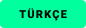

<div align="center">

<p align="center">
  
</p>

<p align="center">
  
</p>

# ANTICORE

### Suite open-source haute performance de contournement DPI et de liberté réseau pour Windows et macOS sans perte de débit

[](https://github.com/MonarchDevLab/Anticore/releases/latest)
[](https://github.com/MonarchDevLab/Anticore/releases/latest)
[](https://github.com/MonarchDevLab/Anticore/releases/latest)
[](https://github.com/MonarchDevLab/Anticore)
[](https://github.com/MonarchDevLab/Anticore)
[](https://github.com/MonarchDevLab/Anticore)
[](https://github.com/MonarchDevLab/Anticore)
[](https://github.com/MonarchDevLab/Anticore/releases/latest)
[](LICENSE)

<br />

<p align="center">
  <a href="README.md"></a>&nbsp;
  <a href="README.en.md"></a>&nbsp;
  <a href="README.ru.md"></a>&nbsp;
  <a href="README.de.md"></a>&nbsp;
  <a href="README.fr.md"></a>
</p>

<br />

**Moteur de manipulation de paquets local de nouvelle génération conçu pour contourner la censure des FAI et les boîtes d'inspection approfondie des paquets (DPI). Fonctionne entièrement en local sans routage vers des serveurs VPN ou proxys tiers — préservant 100 % de votre débit et de votre latence.**

<br />

<table width="100%" align="center">
  <tr>
    <td width="25%" align="center">
      <a href="#options-de-téléchargement-v039"></a>
    </td>
    <td width="25%" align="center">
      <a href="#quest-ce-que-anticore"></a>
    </td>
    <td width="25%" align="center">
      <a href="#fonctionnalités-clés"></a>
    </td>
    <td width="25%" align="center">
      <a href="#fonctionnement"></a>
    </td>
  </tr>
</table>

</div>

---

## Options de téléchargement (v0.3.9)

Tous les exécutables sont directement compilés depuis les sources, exempts de chemins de construction (Zero Leakage) et signés avec Minisign.

<table width="100%" align="center">
  <thead>
    <tr>
      <th width="33.3%" align="center">
        <br /><br />
        <b>Version Portable (EXE)</b><br />
        <small>Sans installation. Prêt à l'emploi depuis un dossier ou une clé USB. Ne modifie pas le registre.</small>
      </th>
      <th width="33.3%" align="center">
        <br /><br />
        <b>Installateur Standard (EXE)</b><br />
        <small>Raccourcis bureau et menu démarrer, mises à jour automatiques et désinstallation propre.</small>
      </th>
      <th width="33.3%" align="center">
        <br /><br />
        <b>Package Entreprise (MSI)</b><br />
        <small>Pour déploiements via Active Directory GPO, Microsoft Intune ou SCCM.</small>
      </th>
    </tr>
  </thead>
  <tbody>
    <tr>
      <td align="center" valign="middle">
        <a href="https://github.com/MonarchDevLab/Anticore/releases/download/v0.3.9/Anticore.exe"></a>
      </td>
      <td align="center" valign="middle">
        <a href="https://github.com/MonarchDevLab/Anticore/releases/download/v0.3.9/Anticore_0.3.9_x64-setup.exe"></a>
      </td>
      <td align="center" valign="middle">
        <a href="https://github.com/MonarchDevLab/Anticore/releases/download/v0.3.9/Anticore_0.3.9_x64_en-US.msi"></a>
      </td>
    </tr>
    <tr>
      <td align="center" bgcolor="#161b22">
        <a href="https://github.com/MonarchDevLab/Anticore/releases/download/v0.3.9/Anticore.exe"></a>
      </td>
      <td align="center" bgcolor="#161b22">
        <a href="https://github.com/MonarchDevLab/Anticore/releases/download/v0.3.9/Anticore_0.3.9_x64-setup.exe"></a>
      </td>
      <td align="center" bgcolor="#161b22">
        <a href="https://github.com/MonarchDevLab/Anticore/releases/latest"></a>
      </td>
    </tr>
  </tbody>
</table>

### Station Mobile Android (v0.3.9)

Client natif de contournement DNS & DPI pour Android (API 26 / Android 8.0+) :

<table width="100%" align="center">
  <thead>
    <tr>
      <th width="50%" align="center">
        <br /><br />
        <b>Paquet APK Universel</b><br />
        <small>Architectures ARM64 (aarch64), ARMv7 et x86_64 prises en charge.</small>
      </th>
      <th width="50%" align="center">
        <br /><br />
        <b>Sans Root & Traitement Local</b><br />
        <small>Aucun privilège root requis ; contourne la censure directement sur l'appareil via tunnel local.</small>
      </th>
    </tr>
  </thead>
  <tbody>
    <tr>
      <td align="center" valign="middle">
        <a href="https://github.com/MonarchDevLab/Anticore/releases/download/v0.3.9/Anticore-v0.3.9.apk"></a>
      </td>
      <td align="center" valign="middle">
        
      </td>
    </tr>
  </tbody>
</table>

<br />

### Packages macOS (Apple Silicon & Intel)

<table width="100%" align="center">
  <thead>
    <tr>
      <th width="50%" align="center"><b>Apple Silicon (arm64)</b></th>
      <th width="50%" align="center"><b>Intel Mac (x64)</b></th>
    </tr>
  </thead>
  <tbody>
    <tr>
      <td align="center">
        <a href="https://github.com/MonarchDevLab/Anticore/releases/download/v0.3.9/Anticore_0.3.9_arm64.pkg"></a>&nbsp;
        <a href="https://github.com/MonarchDevLab/Anticore/releases/download/v0.3.9/Anticore_0.3.9_aarch64.dmg"></a>
      </td>
      <td align="center">
        <a href="https://github.com/MonarchDevLab/Anticore/releases/download/v0.3.9/Anticore_0.3.9_x64.pkg"></a>&nbsp;
        <a href="https://github.com/MonarchDevLab/Anticore/releases/download/v0.3.9/Anticore_0.3.9_x64.dmg"></a>
      </td>
    </tr>
  </tbody>
</table>

#### Installation rapide macOS en une seule ligne (Terminal)
```bash
curl -fsSL https://raw.githubusercontent.com/MonarchDevLab/Anticore/main/scripts/macos-quick-install.sh | bash
```

---

## Tableau des sommes de contrôle SHA-256

| Fichier | Taille | Somme de contrôle SHA-256 |
|---|---|---|
| `Anticore_0.3.9_x64-setup.exe` | 4.79 MB | `81F1B82E5D7111FD02AE0E5B3B7824A1CE8CB597BB6A918A712A5023DCCE4560` |
| `Anticore.exe` | 17.58 MB | `2C0086DE67D725687B26CE946BE90B5CDA4D622B1690FC6FDAA4B620B63A512B` |
| `Anticore_0.3.9_x64_en-US.msi` | 6.88 MB | `1E712FDF07CCE6D9F412B206B7C41E3388A51F20F4170A51A3C3045EA47BDB8C` |
| `Anticore_0.3.9_x64-portable.zip` | 6.77 MB | `9E42DCD01342E75399F051EFDF9F013DCF8E3027AEE91F409608E20C79F25517` |
| `Anticore-v0.3.9.apk` (Android) | 47.40 MB | `8FC1775A54B7F0632ABC0B30C4133C62FB6CD6A6732D299BDE4C9703EC93E278` |
| `Anticore_0.3.9_arm64.pkg` | 6.69 MB | `752645914DA7DB08CCA4C3FA278C9269FD4CC8E75DF61FAB8B31D7A7CFC4A67E` |
| `Anticore_0.3.9_aarch64.dmg` | 6.67 MB | `3718950D281A3ADB3338E2B6D6B6C37BCFBA400C73BBB22C7D3E01A04855E0CA` |
| `Anticore_0.3.9_x64.pkg` | 6.99 MB | `BB3E7ED3B1CEC5F875B23D2369820BB3C43269FF9AEC19707E4794197205F4D3` |
| `Anticore_0.3.9_x64.dmg` | 6.93 MB | `EF6FE6B305AAA66ECEADF362B65B89F77F62BBF0D5A4616A473548774CE3E60E` |

---

## Qu'est-ce qu'Anticore ?

Anticore est un logiciel open-source de contournement DPI développé en **Rust** avec une interface utilisateur moderne en **Tauri 2.0 + React 19**.
Il manipule les paquets réseau directement dans la pile IP du système (WinDivert sous Windows, UTUN/pfctl sous macOS) pour empêcher les équipements de censure (DPI) de détecter les domaines consultés (SNI).

---

## Fonctionnalités clés

1. **Fragmentation avancée des paquets :** Découpage SNI (SNI Mid Split), manipulation d'en-têtes HTTP, octets OOB (Out-of-Band).
2. **Défense passive contre les RST :** Neutralisation des paquets TCP RST falsifiés émis par les FAI.
3. **Blocage QUIC (UDP 443) :** Bascule vers TLS 1.3 sur TCP pour éliminer les écrans noirs sur les flux vidéo.
4. **Partage réseau local (LAN Share & Proxy) :** Port `10808` pour consoles (PS5, Xbox, Switch) et mobiles (iOS, Android) avec résolveur DNS de secours (Cloudflare / Google) contre l'empoisonnement DNS.
5. **Module d'assistance intégré :** Envoi simplifié de rapports d'incident et de suggestions depuis l'application.
6. **Support multilingue :** Français, Anglais, Turc, Russe, Allemand.

---

## Licence

Sous licence open-source MIT.
Tous les droits sont réservés à **Monolith Works**. Publication via **MonarchDevLab**.
